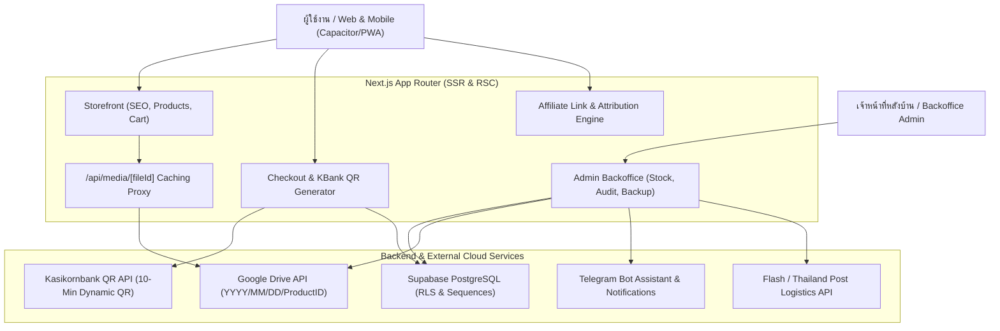
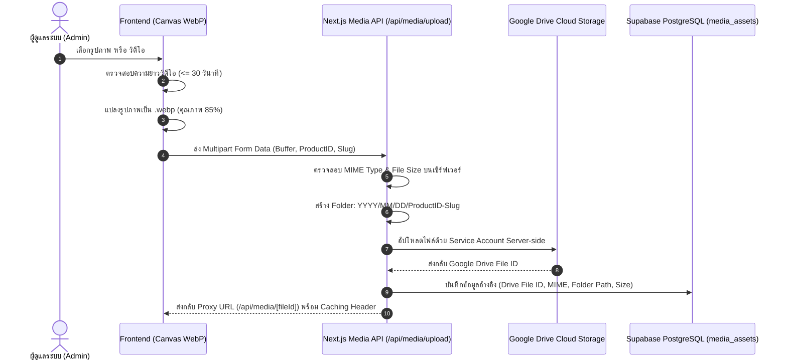
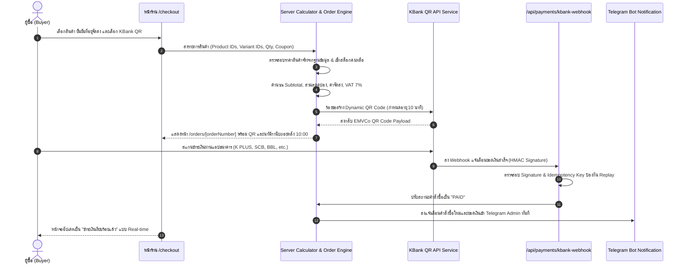
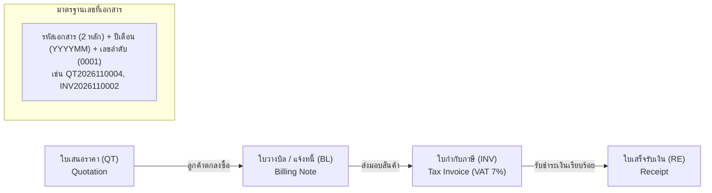

# แผนผังสถาปัตยกรรมระบบ (System Architecture & Integration Flows)
## Siam Commerce Hub - Next.js, Supabase, Google Drive, KBank QR, Telegram & Accounting

---

### 1. ภาพรวมสถาปัตยกรรมระบบ (High-Level Architecture)

---

### 2. แผนผังการจัดเก็บสื่อและแปลงไฟล์ (Media & Google Drive Flow)

---

### 3. แผนผังกระบวนการสั่งซื้อและชำระเงิน KBank QR 10 นาที (Payment Flow)

---

### 4. แผนผังการส่งต่อเอกสารบัญชีภาษีไทย (Thai Tax Document Chaining)

---

### 5. แนวทางและข้อจำกัดของแอปบน iOS และ Android (Capacitor & PWA)

#### สถาปัตยกรรม Capacitor / PWA:
1. **Web Core:** รัน Next.js App Router แบบ Responsive รองรับหน้าจอสมาร์ตโฟน 100%
2. **Capacitor Integration:** สามารถเพิ่ม `@capacitor/core`, `@capacitor/ios`, `@capacitor/android` เพื่อห่อหุ้ม Webview เป็น Native App บน App Store และ Google Play Store

#### ตารางข้อจำกัดของแต่ละแพลตฟอร์ม (Platform Limitations):

| คุณสมบัติ | Web Browser (PWA) | iOS (Safari / WebKit) | Android (Chrome / WebView) |
| :--- | :--- | :--- | :--- |
| **การติดตั้งลงเครื่อง** | Add to Home Screen | Add to Home Screen (ต้องกดยืนยันผ่าน Share Sheet) | WebAPK ติดตั้งได้โดยตรงเหมือน Native App |
| **Push Notifications** | Web Push API (ต้องได้รับ Consent) | รองรับตั้งแต่ iOS 16.4+ (ต้องติดตั้งแบบ PWA ก่อน) | รองรับสมบูรณ์ผ่าน Firebase Cloud Messaging (FCM) |
| **อายุ Session** | จัดการผ่าน Server-side Activity (2 เดือน) | WebKit ITP อาจล้าง Client Cookie หากไม่ได้เข้านานเกิน 7 วัน (ต้องใช้ Server Token) | เก็บ Session ใน LocalStorage/Cookies ได้คงทน |
| **การสแกน QR Code** | ใช้ Camera API (HTML5 Canvas) | ต้องขออนุญาตกล้องผ่าน Safari Permission | รองรับ WebRTC & BarcodeDetector API |
| **ข้อจำกัดสโตร์** | ไม่มีค่าธรรมเนียม Store | Apple Review Guidelines 3.1.1 (สินค้าดิจิทัลต้องใช้ IAP, สินค้ากายภาพใช้ KBank QR ได้) | Google Play Policy (สินค้าจัดส่งทางกายภาพยกเว้นจาก Google Billing ได้) |
